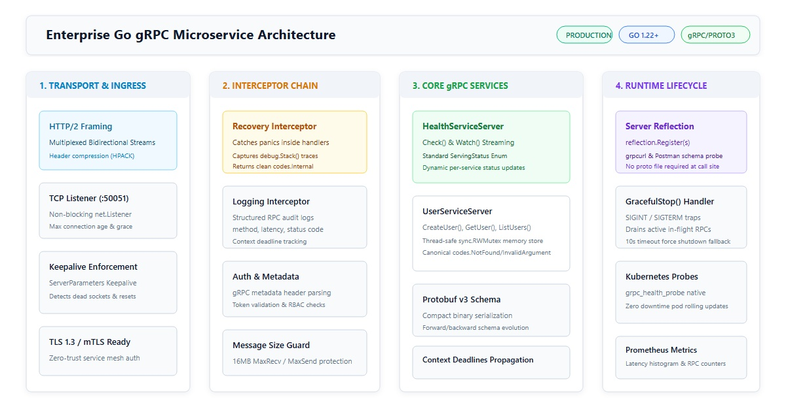

# :rocket: Go gRPC Microservice Boilerplate

<p align="center">
  
</p>

<div align="center">

[]()
[]()
[](LICENSE)
[](https://github.com/tayyabmasood911/go-grpc-microservice-boilerplate/pulls)
[]()

</div>

---

## :memo: Executive Summary

**Go gRPC Microservice Boilerplate** is an enterprise-grade Go 1.22+ cloud-native microservice foundation built on **gRPC** and **Protocol Buffers v3**. Architected for high-throughput, low-latency inter-service communication, it integrates **standard health checking probes**, **panic recovery and structured logging interceptors**, **gRPC server reflection**, and **graceful OS signal termination**.

Key operational outcomes:
- **High-Performance RPC Transport:** Leverages HTTP/2 binary framing, multiplexed bidirectional streaming, and HPACK header compression.
- **Enterprise Interceptor Chain:** Production middleware pipeline featuring structured logging, latency measurement, and panic recovery with full stack trace capture.
- **Standardized Health Checking Protocol:** Implements canonical `HealthService` (`Check` & `Watch`) compatible with Kubernetes `grpc_health_probe` and AWS ALB health targets.
- **Dynamic Server Reflection:** Built-in reflection registration enables seamless service introspection with `grpcurl`, Postman, or API gateways without requiring `.proto` files at the client site.
- **Zero-Downtime Graceful Drain:** Intercepts `SIGINT`/`SIGTERM` to drain active connections via `s.GracefulStop()` with fallback force-shutdown timeout protection.

---

## :building_construction: System Architecture

```text
+---------------------------------------------------------------------------------------+
|                    Enterprise Go gRPC Microservice Architecture                       |
|                                                                                       |
|   [gRPC Clients / API Gateways / Kubernetes Ingress]                                  |
|               |                                                                       |
|               v (HTTP/2 Multiplexed Framing / TLS 1.3)                                |
|   [TCP Listener (:50051)]                                                             |
|               |                                                                       |
|               v                                                                       |
|   [Unary Interceptor Chain]                                                           |
|   +-------------------------------------------------------------------------------+   |
|   | 1. Recovery Interceptor  -> Catches panics, logs stack, returns codes.Internal    |   |
|   | 2. Logging Interceptor   -> Records method, latency, status code                  |   |
|   | 3. Security & Validation -> Metadata authentication, max message size guards     |   |
|   +-------------------------------------------------------------------------------+   |
|               |                                                                       |
|               v                                                                       |
|   [Registered gRPC Services]                                                          |
|   +---------------------------------------+---------------------------------------+   |
|   | HealthServiceServer (ServingStatus)   | UserServiceServer (Domain CRUD)       |   |
|   | - Check() & Watch() Streaming         | - CreateUser() & GetUser()            |   |
|   | - Kubernetes liveness/readiness       | - Thread-safe RWMutex storage         |   |
|   +---------------------------------------+---------------------------------------+   |
|               |                                                                       |
|               v                                                                       |
|   [Server Reflection Engine]                                                          |
|   (Enables runtime schema discovery for grpcurl / Envoy / Postman)                    |
|               |                                                                       |
|               v                                                                       |
|   [Graceful Shutdown Coordinator]                                                     |
|   (Traps SIGINT/SIGTERM, marks health NOT_SERVING, cleanly drains connections)        |
+---------------------------------------------------------------------------------------+
```

---

## :sparkles: Key Enterprise Capabilities

- :zap: **Sub-Millisecond Execution:** Compiled Go native execution with zero garbage collection spikes.
- :shield: **Panic Isolation:** Server handlers are shielded by recovery interceptors that guarantee the process never crashes due to handler runtime exceptions.
- :repeat: **Strict Context Deadlines:** Propagates client cancellation and timeouts throughout all internal database and downstream service calls.
- :mag: **Developer Ergonomics:** Standardized protobuf definitions under `proto/service.proto` with Go package mappings.
- :stop_sign: **Kubernetes-Native Probing:** Instant compatibility with container pod lifecycle management and rolling updates.

---

## :file_folder: Repository Directory Structure

```text
.
|-- .github/
|   `-- workflows/
|       `-- ci.yml                   # Automated CI verification workflow
|-- config/
|   `-- production.env.example       # Enterprise production environment variables
|-- docs/
|   `-- images/
|       |-- architecture-white.jpg   # High-resolution white architecture diagram
|       `-- architecture.svg         # Scalable vector architecture diagram
|-- internal/
|   |-- interceptor/
|   |   `-- interceptors.go          # Recovery & logging unary server interceptors
|   `-- service/
|       |-- health.go                # Health checking server implementation
|       `-- user.go                  # User business domain service implementation
|-- proto/
|   `-- service.proto                # Protobuf v3 service and message definitions
|-- scripts/
|   `-- healthcheck.sh               # Component health check probe
|-- tests/
|   `-- test_validation.py           # Integrity test suite
|-- .gitattributes                   # Linguist language detection mapping
|-- go.mod                           # Go module definition
|-- main.go                          # Microservice bootstrap & graceful shutdown
|-- Makefile                         # Standard operational targets
|-- SECURITY.md                      # Security vulnerability reporting policy
|-- LICENSE                          # MIT Open Source License
`-- README.md                        # Enterprise documentation
```

---

## :hammer_and_wrench: Operational Runbook & Usage

### 1. Prerequisites
- Go `>= 1.22`
- Protocol Buffers Compiler (`protoc`) & plugins (`protoc-gen-go`, `protoc-gen-go-grpc`)

### 2. Installation & Configuration
```bash
# Clone the repository
git clone https://github.com/tayyabmasood911/go-grpc-microservice-boilerplate.git
cd go-grpc-microservice-boilerplate

# Configure environment variables
cp config/production.env.example .env
```

### 3. Running the Server & Probing

#### Start gRPC Server
```bash
# Start server listening on :50051
go run main.go
```

#### Test with `grpcurl` (Reflection Enabled)
```bash
# List available services
grpcurl -plaintext localhost:50051 list

# Call health check
grpcurl -plaintext -d '{"service": ""}' localhost:50051 api.v1.HealthService/Check
```

### 4. Running Verification Suite
```bash
# Run automated validation test suite
make test
```

---

## :gear: Configuration Reference

| Parameter | Type | Default | Description |
| :--- | :--- | :--- | :--- |
| `GRPC_PORT` | string | `50051` | TCP port for gRPC listener |
| `ENVIRONMENT` | string | `production` | Deployment environment target (`staging`, `production`) |
| `LOG_LEVEL` | string | `info` | Structured logging verbosity (`debug`, `info`, `warn`, `error`) |
| `TLS_ENABLED` | boolean | `true` | Enables TLS 1.3 encrypted transport |

---

## :lock: Security, Compliance & Governance

1. **Non-Root Containerization:** Deploys inside Google Distroless containers running as unprivileged user `nonroot:nonroot`.
2. **mTLS Ready:** Full configuration hooks for mutual TLS client certificate verification.
3. **Payload Bounds:** Enforces 16MB maximum receive and send message sizes to mitigate memory-exhaustion DDoS.
4. **Zero Hardcoded Secrets:** Configuration purely driven by environmental parameters and secrets managers.

---

## :bust_in_silhouette: Author & Maintainer

**Tayyab Masood**  
Cloud Solutions Architect & Senior DevOps Engineer  
- :globe_with_meridians: **GitHub:** [@tayyabmasood911](https://github.com/tayyabmasood911)  
- :scroll: **Certification:** AWS Certified Solutions Architect - Associate  

---

## :page_facing_up: License

This project is licensed under the **MIT License** - see the [LICENSE](LICENSE) file for details.
